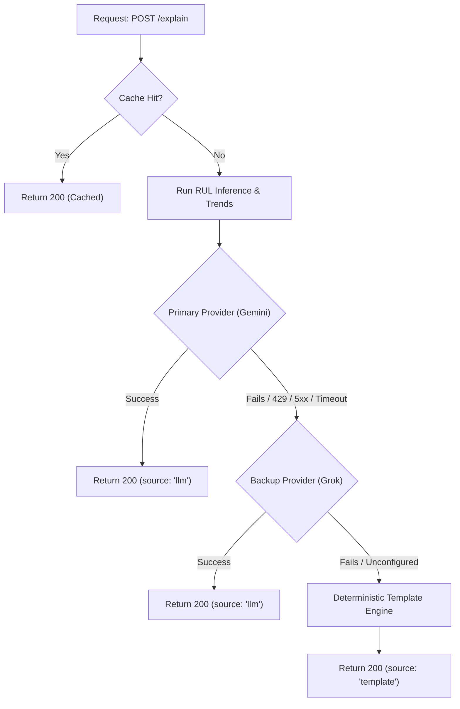

# Turbofan Remaining Useful Life (RUL) Prediction API

FastAPI backend service for predicting the Remaining Useful Life (RUL) of turbofan aircraft engines using sensory time-series data from the **NASA C-MAPSS FD001** dataset.

---

## 🔒 Security Notice: Artifact Deserialization

> [!CAUTION]
> Serialized model artifacts (`.pkl` files) are loaded using Python's `pickle` and `joblib` libraries. Deserialization of untrusted data can lead to arbitrary code execution. **Only load artifact files from trusted, verified sources** in secure deployment pipelines. Never run untrusted `.pkl` files.

---

## 📐 Model & Artifact Specifications

The backend serves a trained deep learning recurrent model with the following verified specifications:

- **Architecture:** GRU (`gru_4 (GRU) -> Dropout -> Dense(32) -> Dense(1)`)
- **Input Window Size:** 30 consecutive operating cycles
- **Input Features (22 total):**
  - **3 Operating Settings:** `setting_1`, `setting_2`, `setting_3`
  - **19 Sensors:** `sensor_1` through `sensor_17`, `sensor_20`, `sensor_21` (sensors 18 and 19 removed due to zero/near-zero variance)
- **Input Tensor Shape:** `(batch_size, 30, 22)`
- **Normalization:** `StandardScaler` fitted on the 22 features
- **RUL Threshold / Ceiling:** 125 cycles (clipping target applied during training and inference)
- **Health Status Categorization:**
  - 🚨 **Critical:** Predicted RUL $\le 30.0$ cycles
  - ⚠️ **Warning:** $30.0 <$ Predicted RUL $\le 75.0$ cycles
  - ✅ **Healthy:** Predicted RUL $> 75.0$ cycles

---

## 📁 Repository Structure

```text
rul-prediction-app/
├── backend/
│   ├── app/
│   │   ├── __init__.py
│   │   ├── config.py             # Dynamic configuration & path resolution
│   │   ├── schemas.py            # Pydantic v2 validation models
│   │   ├── predictor.py          # Artifact loader, scaler, & GRU inference engine
│   │   ├── insights.py           # Deterministic sensor trend analysis & normalized ranking
│   │   ├── llm.py                # LLM provider abstraction, retries, & template fallback
│   │   ├── cache.py              # In-memory TTL cache & sliding-window IP rate limiter
│   │   └── main.py               # FastAPI application, lifespan, & endpoints
│   ├── artifacts/
│   │   ├── final_rul_model.keras # Trained Keras GRU model
│   │   ├── rul_scaler.pkl        # Fitted StandardScaler
│   │   ├── feature_columns.pkl   # Ordered list of 22 feature names
│   │   ├── model_config.pkl      # Architecture and window metadata
│   │   └── best_hyperparameters.pkl
│   ├── scripts/
│   │   └── inspect_artifacts.py  # Utility script to inspect saved artifacts
│   ├── tests/
│   │   ├── test_api.py           # Core API & prediction test suite
│   │   ├── test_insights.py      # Telemetry trends & ranking unit tests
│   │   └── test_explain.py       # LLM fallback, caching, rate limiting, & security tests
│   ├── .env.example              # Environment variables template
│   ├── pytest.ini                # Pytest configuration
│   └── requirements.txt          # Pinned dependencies
├── frontend/                     # React + Vite + TypeScript single-page app
│   ├── src/
│   │   ├── api/                  # Typed API client & request/response interfaces
│   │   ├── components/           # Stepper, DataStep, AnalyseStep, ResultsStep, AiSummarySection, etc.
│   │   └── hooks/                # useFlowState, useCountUp, useTheme, useToast
├── notebooks/                    # EDA & training notebooks
├── .gitignore
└── README.md
```

---

## 🚀 Getting Started

### 1. Prerequisites
- macOS or Linux with **Python 3.11** installed.
- Virtual environment created at `backend/.venv`.

### 2. Activate Virtual Environment & Install Dependencies
```bash
cd backend
source .venv/bin/activate
pip install -r requirements.txt
```

### 3. Environment Configuration (Optional)
Copy `.env.example` to `.env` to customize settings:
```bash
cp .env.example .env
```
Default configuration values:
- `LOG_LEVEL=INFO`
- `HEALTH_THRESHOLD_CRITICAL=30.0`
- `HEALTH_THRESHOLD_WARNING=75.0`
- `MAX_BATCH_SIZE=32`
- `CORS_ORIGINS=http://localhost:3000,http://localhost:5173`

---

## 🏃 Running the API Server

Start the development server with hot-reload from the `backend/` directory:

```bash
cd backend
uvicorn app.main:app --reload --host 127.0.0.1 --port 8000
```

> [!NOTE]
> All artifact paths in `config.py` are resolved relative to the file location, so the server can also be launched safely from the repository root:
> ```bash
> uvicorn backend.app.main:app --reload
> ```

---

## 📖 Interactive Documentation (Swagger UI)

Once the server is running, open your browser to:
- **Swagger UI:** [http://127.0.0.1:8000/docs](http://127.0.0.1:8000/docs)
- **ReDoc:** [http://127.0.0.1:8000/redoc](http://127.0.0.1:8000/redoc)

### What you will see at `/docs`:
- **Interactive UI:** Pre-filled schema examples for single and batch predictions.
- **Tagged Endpoint Groups:**
  - 🩺 **Health:** `/health`
  - ℹ️ **Model Info:** `/model/info`
  - 🔮 **Predictions:** `/sample-input`, `/predict`, and `/predict/batch`
- **Instant Testing:** You can click **"Try it out"** on `/sample-input` to get a valid 30-cycle payload, then paste it directly into `/predict` to execute inference.

---

## 🧪 Running Automated Tests

Run the test suite with `pytest`:

```bash
cd backend
pytest -v
```

All 16 test cases verify:
- Health check and model metadata retrieval.
- Single engine prediction with 30x22 list-of-lists format.
- Single engine prediction with dictionary-of-features format (verifying automatic feature reordering).
- Strict schema validation rejecting 29 cycles, 31 cycles, missing/extra features, string values, and NaN/infinite values.
- Batch prediction execution and batch size cap enforcement ($> 32$ engines rejected with HTTP 422).

---

## 📡 API Endpoints & Example `curl` Commands

### 1. Health Check
```bash
curl -X GET "http://127.0.0.1:8000/health"
```
**Response:**
```json
{
  "status": "healthy",
  "model_loaded": true,
  "timestamp": "2026-11-20T10:00:00.000000+00:00"
}
```

---

### 2. Model Metadata
```bash
curl -X GET "http://127.0.0.1:8000/model/info"
```
**Response:**
```json
{
  "model_type": "GRU",
  "model_version": "1.0.0-cmapss-gru",
  "window_size": 30,
  "n_features": 22,
  "feature_names": [
    "setting_1", "setting_2", "setting_3",
    "sensor_1", "sensor_2", "sensor_3", "sensor_4", "sensor_5",
    "sensor_6", "sensor_7", "sensor_8", "sensor_9", "sensor_10",
    "sensor_11", "sensor_12", "sensor_13", "sensor_14", "sensor_15",
    "sensor_16", "sensor_17", "sensor_20", "sensor_21"
  ],
  "rul_cap": 125.0,
  "health_thresholds": {
    "critical_lte": 30.0,
    "warning_lte": 75.0
  }
}
```

---

### 3. Fetch Sample Input Payload
```bash
curl -X GET "http://127.0.0.1:8000/sample-input"
```

---

### 4. Single Engine Prediction (`POST /predict`)

#### Option A: Pipelining sample input directly:
```bash
curl -s "http://127.0.0.1:8000/sample-input" | jq '.payload' | \
curl -X POST "http://127.0.0.1:8000/predict" \
  -H "Content-Type: application/json" \
  -d @-
```

#### Option B: Direct payload:
```bash
curl -X POST "http://127.0.0.1:8000/predict" \
  -H "Content-Type: application/json" \
  -d '{
    "readings": [
      [-0.000007, 0.000002, 100.0, 518.67, 642.68, 1590.49, 1408.88, 14.62, 21.61, 553.37, 2388.10, 9065.40, 1.30, 47.54, 521.42, 2388.10, 8143.91, 8.44, 0.03, 393.21, 38.82, 23.29],
      ... (30 cycles total)
    ]
  }'
```
**Response:**
```json
{
  "predicted_rul": 114.54,
  "rul_cap": 125.0,
  "window_size": 30,
  "model_type": "GRU",
  "model_version": "1.0.0-cmapss-gru",
  "health_status": "healthy"
}
```

---

### 5. Batch Engine Prediction (`POST /predict/batch`)
```bash
curl -X POST "http://127.0.0.1:8000/predict/batch" \
  -H "Content-Type: application/json" \
  -d '{
    "engines": [
      {
        "readings": [ ... (30x22 window for Engine 1) ]
      },
      {
        "readings": [ ... (30x22 window for Engine 2) ]
      }
    ]
  }'
```
**Response:**
```json
{
  "predictions": [
    {
      "predicted_rul": 114.54,
      "rul_cap": 125.0,
      "window_size": 30,
      "model_type": "GRU",
      "model_version": "1.0.0-cmapss-gru",
      "health_status": "healthy"
    },
    {
      "predicted_rul": 114.54,
      "rul_cap": 125.0,
      "window_size": 30,
      "model_type": "GRU",
      "model_version": "1.0.0-cmapss-gru",
      "health_status": "healthy"
    }
  ],
  "total_engines": 2
}
```

---

## 🤖 LLM-Powered Prognostic Summaries (`POST /explain`)

The service includes an LLM explanation engine providing natural-language operational interpretations and technical engineering briefs for RUL predictions.

### 1. Multi-Provider Fallback Architecture


- **Primary Provider:** **Google Gemini** (via Google AI Studio REST API).
- **Backup Provider:** **Grok** (via xAI OpenAI-compatible REST API).
- **Graceful Fallback:** If both LLM providers fail or are disabled, the endpoint returns an automatic deterministic summary (`source = "template"`).
- **Decoupled Architecture:** The prediction engine (`POST /predict`) is completely isolated and never blocked or slowed down by LLM calls.

---

### 2. Obtaining API Keys

#### A. Free Google Gemini API Key (Google AI Studio)
1. Visit [Google AI Studio](https://aistudio.google.com/).
2. Sign in with your Google account.
3. Click **"Get API key"** and choose or create a Google Cloud Project.
4. Copy the API key and set it as `GEMINI_API_KEY` in `backend/.env`.

#### B. Grok API Key (xAI Console)
1. Visit the [xAI Console](https://console.x.ai/).
2. Sign in or create an account.
3. Navigate to **"API Keys"** and click **"Create API Key"**.
4. Copy the API key and set it as `GROK_API_KEY` in `backend/.env`.

---

### 3. Environment Configuration

Configure providers in `backend/.env`:

```bash
# ==============================================================================
# LLM Provider Configuration for /explain
# ==============================================================================

# Primary Provider: Google Gemini (Google AI Studio)
GEMINI_API_KEY=your_gemini_api_key_here

# Backup Provider: Grok (xAI API)
GROK_API_KEY=your_grok_api_key_here

# Provider Routing & Models
LLM_PRIMARY_PROVIDER=gemini
LLM_BACKUP_PROVIDER=grok
GEMINI_MODEL=gemini-1.5-flash
GROK_MODEL=grok-beta

# Network Timeout and Toggles
LLM_TIMEOUT_SECONDS=15.0
LLM_ENABLED=true

# Rate Limiting (per IP per minute) & TTL Cache (seconds)
EXPLAIN_RATE_LIMIT_PER_MIN=60
EXPLAIN_CACHE_TTL_SECONDS=300
```

#### How to Switch Primary and Backup Providers
Change the routing variables in `backend/.env`:
```bash
# Set Grok as primary and Gemini as backup:
LLM_PRIMARY_PROVIDER=grok
LLM_BACKUP_PROVIDER=gemini
```

---

### 4. Testing the `/explain` Endpoint

#### Calling `/explain` via `curl`:
```bash
curl -X POST http://127.0.0.1:8000/explain \
  -H "Content-Type: application/json" \
  -d '{
    "readings": [ ... 30 cycles x 22 features ... ],
    "audience": "general",
    "language": "en"
  }'
```

**Response Format:**
```json
{
  "summary": "This engine has an estimated Remaining Useful Life of 45.2 cycles, subject to the model cap of 125 cycles. Its condition is currently rated as WARNING condition with noticeable sensor divergence. Key telemetry indicators showing the highest relative drift include sensor_4 (rising by 2.5%), sensor_11 (falling by 1.8%). Next step: Increase cycle monitoring frequency and schedule preventive inspection within the next 20 operating cycles. This is a demo model trained on NASA C-MAPSS FD001 and is not intended for real maintenance decisions.",
  "source": "llm",
  "facts": {
    "predicted_rul": 45.2,
    "rul_cap": 125.0,
    "health_status": "warning",
    "top_features": [
      {
        "name": "sensor_4",
        "trend": "rising",
        "percentage_change": 2.45,
        "normalized_change": 1.25,
        "first_5_mean": 1408.2,
        "last_5_mean": 1419.5
      }
    ],
    "constant_features": ["setting_3", "sensor_1"]
  },
  "model": "gemini-1.5-flash"
}
```

---

### 5. Simulating Failures & Fallbacks

#### A. Simulating Gemini Failure (Automatic Grok Fallback)
Set an invalid key for Gemini while keeping a valid Grok key:
```bash
GEMINI_API_KEY=invalid_dummy_key_to_force_failure
GROK_API_KEY=your_valid_grok_key
```
Call `/explain`: The server logs a warning that Gemini failed, automatically routes the request to Grok, and returns:
```json
{
  "source": "llm",
  "model": "grok-beta"
}
```

#### B. Simulating Both Providers Unavailable (Deterministic Template Fallback)
Set `LLM_ENABLED=false` or omit both API keys:
```bash
LLM_ENABLED=false
```
Call `/explain`: The endpoint immediately returns HTTP 200 with deterministic template output:
```json
{
  "source": "template",
  "model": null
}
```
The template summary strictly includes the predicted RUL, 125 cycle ceiling, health status, top sensor trends, and the exact NASA disclaimer.

---

## 💻 Frontend Application (React + Vite + TypeScript + Tailwind)

The `frontend/` directory contains a single-page prognostic dashboard for operators to inspect sensor trajectories and evaluate Remaining Useful Life.

### 1. Installation
```bash
cd frontend
npm install
```

### 2. Development Server
```bash
cd frontend
npm run dev
```
The application will launch at [http://localhost:5173](http://localhost:5173).

### 3. Production Build
```bash
cd frontend
npm run build
```

### 4. Running Backend and Frontend Together
In Terminal 1 (FastAPI backend):
```bash
cd backend
source .venv/bin/activate
uvicorn app.main:app --reload --host 127.0.0.1 --port 8000
```

In Terminal 2 (React frontend):
```bash
cd frontend
npm run dev
```

Visit [http://localhost:5173](http://localhost:5173) in your browser. The live backend status indicator in the top header will display **"Backend Online · Model Ready"** in green once connected.


