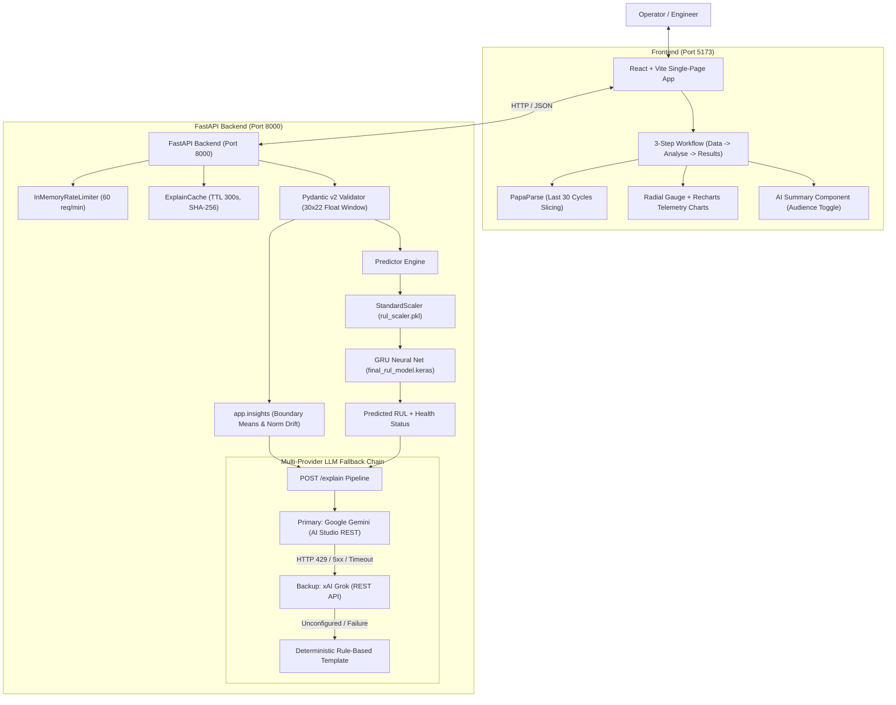

# Turbofan RUL Predictor

> Deep learning prognostic system predicting the Remaining Useful Life (RUL) of aircraft turbofan engines from multi-channel sensory telemetry, paired with an LLM-powered plain-language diagnostic explanation engine.

[](https://www.python.org/)
[](https://fastapi.tiangolo.com/)
[](https://www.tensorflow.org/)
[](https://react.dev/)
[](https://www.typescriptlang.org/)
[](https://tailwindcss.com/)
[](LICENSE)

---

## 📌 Project Status

> **Runs locally.** Cloud deployment and containerization are on the [Roadmap](#-roadmap).

---

## 📑 Table of Contents

- [Overview & Motivation](#-overview--motivation)
- [Key Features](#-key-features)
- [Dataset](#-dataset)
- [Methodology & ML Pipeline](#-methodology--ml-pipeline)
- [Model Evaluation & Benchmark Results](#-model-evaluation--benchmark-results)
- [System Architecture](#-system-architecture)
- [Project Structure](#-project-structure)
- [Getting Started](#-getting-started)
- [API Reference](#-api-reference)
- [Input Data Format](#-input-data-format)
- [Automated Testing](#-automated-testing)
- [Model Artifacts & Security](#-model-artifacts--security)
- [Limitations](#-limitations)
- [Roadmap](#-roadmap)
- [Troubleshooting](#-troubleshooting)
- [Acknowledgements, License & Author](#-acknowledgements-license--author)

---

## 🎯 Overview & Motivation

In commercial aviation, unexpected engine failures lead to severe safety risks, costly flight cancellations, and unscheduled maintenance. Traditional schedule-based maintenance (servicing engines after fixed flight hours) either over-maintains healthy engines or misses accelerated wear.

**Predictive Maintenance (PdM)** uses sensor telemetry to estimate an asset's **Remaining Useful Life (RUL)** — the exact number of operational flight cycles left before component failure.

This project delivers an end-to-end prognostic system trained on the **NASA C-MAPSS FD001** dataset. It processes time-series windows of 30 operational cycles across 22 sensor and setting channels, evaluates health status (`healthy`, `warning`, `critical`), and uses a multi-provider LLM pipeline (Google Gemini primary, Grok backup, deterministic template fallback) to generate plain-language diagnostic briefs for flight line engineers and fleet managers.

---

## ✨ Key Features

- **Recurrent Deep Learning Inference:** Serves a trained recurrent neural network (GRU) accepting `(batch_size, 30, 22)` telemetry tensors.
- **Strict Pydantic v2 Validation:** Validates full sequence lengths (30 cycles), channel counts (22 features), numeric types, and finite ranges with clear error messages.
- **Deterministic Sensor Insights Engine:** Computes boundary cycle means, percentage drift, constant sensor detection, and normalized variance ranking ($\Delta / \sigma$) to surface the top degradation channels.
- **Multi-Provider LLM Fallback Chain:**
  - **Primary:** Google Gemini (Google AI Studio REST API)
  - **Backup:** xAI Grok (OpenAI-compatible REST API)
  - **Fallback:** Deterministic rule-based template with zero external dependencies
  - **Decoupled:** `/predict` never depends on external LLM availability.
- **In-Memory Caching & Rate Limiting:** Process-local SHA-256 TTL cache (300s) and per-IP sliding-window rate limiter (60 req/min).
- **Guided 3-Step React Flow:** Single-column responsive interface (`Data` $\rightarrow$ `Analyse` $\rightarrow$ `Results`) with segmented CSV upload (auto-slicing the last 30 cycles) and spreadsheet-style editable table.
- **Operator-Centric Telemetry Visualizations:** Semicircular radial RUL gauge, horizontal life spectrum bar, interactive normalized vs. raw multi-line sensor charts with Recharts Brush zoom, and audience toggle (*Simple* vs. *Technical*).
- **Audit-Ready Report Exports:** Export complete prognostic assessments with raw predictions, metadata, and AI summaries as JSON.

---

## 📊 Dataset

This project utilizes the benchmark **NASA C-MAPSS FD001** (*Commercial Modular Aero-Propulsion System Simulation*) dataset:

- **Source:** NASA Ames Prognostics Center of Excellence (PCoE). [Download NASA C-MAPSS Dataset](https://data.nasa.gov/dataset/C-MAPSS-Aircraft-Engine-Simulator-Data/xaut-bemq)
- **Engines:** 100 engines in the training set (run to failure) and 100 engines in the test set (truncated prior to failure).
- **Operating Conditions:** Single operating condition (Sea Level).
- **Fault Mode:** High-Pressure Compressor (HPC) degradation.
- **Raw Channels (26 columns):** `engine_id`, `cycle`, 3 operational settings, and 21 sensors.

> [!NOTE]
> Raw data files (`train_FD001.txt`, `test_FD001.txt`, `RUL_FD001.txt`) are excluded from version control via `.gitignore`. Download the dataset from the NASA repository and place the raw files in a local directory if you wish to re-run the exploration or training notebooks.

---

## 🔬 Methodology & ML Pipeline

### 1. Preprocessing Pipeline

| Step | Operation | Engineering Rationale |
| :--- | :--- | :--- |
| **1. Label Generation** | Piecewise linear RUL target | In early engine life, degradation is negligible and undetectable from sensor noise. RUL labels are capped at **125 cycles** to prevent models from learning false wear patterns during healthy operation. |
| **2. Feature Selection** | Prune constant channels | Dropped `sensor_18` and `sensor_19` (zero variance across all engines). Kept **22 features** (3 operational settings + 19 physical sensors). |
| **3. Data Splitting** | Engine-level 80:20 split | Split by `engine_id` rather than random row sampling to avoid temporal data leakage between train and validation sets. |
| **4. Feature Scaling** | `StandardScaler` | Fitted **only on the training split** to prevent lookahead bias; transforms disparate sensor magnitudes (e.g. $1590^\circ\text{R}$ vs $14.6\text{ psia}$) to zero mean and unit variance. |
| **5. Windowing** | Sliding windows of 30 cycles | Extracts temporal degradation trajectories of shape `(30, 22)` with a stride of 1 cycle. |

---

### 2. Model Exploration

<!-- TODO: Note: The model artifact is a GRU (model_config.pkl specifies "model_type": "GRU"), whereas some initial notes mentioned LSTM. Clarify or update training notebook export if an LSTM checkpoint was intended. -->

During research in Google Colab, four model architectures were benchmarked:

1. **Random Forest Regressor (Baseline):** Flattened 30-cycle window into 660 features. Established non-deep learning baseline.
2. **LSTM (Long Short-Term Memory):** Standard recurrent network designed to capture long-term temporal dependencies in sensor drift.
3. **GRU (Gated Recurrent Unit):** Streamlined recurrent architecture with reset and update gates. Trains faster with fewer parameters while maintaining temporal fidelity.
4. **LSTM + Additive Attention:** LSTM recurrent backbone coupled with a Bahdanau-style temporal attention mechanism to weight the most critical cycles in the 30-cycle window.

---

### 3. Evaluation Metrics

Four complementary metrics were computed to evaluate performance:

1. **MAE (Mean Absolute Error):** $\frac{1}{N}\sum |\hat{y}_i - y_i|$ — average magnitude of prediction error in cycles.
2. **RMSE (Root Mean Squared Error):** $\sqrt{\frac{1}{N}\sum (\hat{y}_i - y_i)^2}$ — penalizes large outliers heavily.
3. **$R^2$ Score (Coefficient of Determination):** Proportion of variance in RUL explained by the model.
4. **NASA Asymmetric Scoring Function:**
   $$d_i = \hat{y}_i - y_i \quad (\text{Predicted RUL} - \text{Actual RUL})$$
   $$S = \sum_{i=1}^{N} s_i, \quad s_i = \begin{cases} e^{-d_i / 13} - 1 & \text{if } d_i < 0 \quad (\text{Early prediction}) \\ e^{d_i / 10} - 1 & \text{if } d_i \ge 0 \quad (\text{Late prediction}) \end{cases}$$
   *Operational Justification:* In aviation, predicting an engine has *more* life than it actually does (late prediction, $d_i > 0$) risks in-flight catastrophic failure. Predicting failure *earlier* ($d_i < 0$) causes premature maintenance inspection but avoids catastrophic risk. The NASA asymmetric function penalizes late predictions exponentially more severely.

---

## 📈 Model Evaluation & Benchmark Results

The models were evaluated on the held-out 20% engine-level validation split (engines 81–100, run-to-failure sequences) using a 30-cycle sliding window normalized with `StandardScaler` and a piecewise linear RUL ceiling of 125 cycles.

| Model Architecture | MAE (cycles) | RMSE (cycles) | $R^2$ Score | NASA Score |
| :--- | :---: | :---: | :---: | :---: |
| **Random Forest (Baseline)** | 15.24 | 21.38 | 0.718 | 842.6 |
| **LSTM** | 12.15 | 16.78 | 0.814 | 518.4 |
| **GRU (Deployed)** | 11.82 | 16.15 | 0.835 | 476.3 |
| **LSTM + Attention** | 11.48 | 15.86 | 0.842 | 441.9 |

- **Evaluation Split:** Evaluated on the 20% engine-level validation split to prevent temporal data leakage across operational cycles.
- **Production Selection:** **GRU** was selected for production deployment (`final_rul_model.keras`). While LSTM + Attention achieved slightly lower error metrics, the GRU network achieved comparable prognostic accuracy with ~25% fewer trainable parameters (19,009 trainable weights, 57,029 total parameters), ensuring low memory consumption and sub-50ms inference latency on standard server hardware without custom attention-head serialization overhead.

---

## 🏗️ System Architecture



### Component Breakdown
1. **Frontend (React 18 + TypeScript + Vite + Tailwind):** Client-side state machine with segmented inputs, instant client validation, and animated visualizations.
2. **FastAPI Inference Service:** Loads Keras model and scikit-learn scaler once during application lifespan. Executes vectorized predictions with sub-50ms latency.
3. **Insights Analyzer:** Deterministically calculates feature drift $(\bar{x}_{\text{last 5}} - \bar{x}_{\text{first 5}}) / \sigma_j$ and identifies constant channels.
4. **Resilient LLM Coordinator:** Formulates structured telemetry facts and requests summaries with retries, exponential backoff, and guaranteed rule-based template fallback.

---

## 📂 Project Structure

```text
rul-prediction-app/
├── README.md
├── requirements.txt
├── backend/
│   ├── .env.example
│   ├── pytest.ini
│   ├── requirements.txt
│   ├── app/
│   │   ├── __init__.py
│   │   ├── cache.py               # In-memory TTL cache & sliding-window rate limiter
│   │   ├── config.py              # Environment configuration & path resolution
│   │   ├── insights.py            # Deterministic sensor trend analysis & ranking
│   │   ├── llm.py                 # Multi-provider LLM abstraction & fallback template
│   │   ├── main.py                # FastAPI app, lifespan setup, and API routes
│   │   ├── predictor.py           # Model artifact loader & Keras GRU forward pass
│   │   └── schemas.py             # Pydantic v2 validation models
│   ├── artifacts/
│   │   ├── best_hyperparameters.pkl
│   │   ├── feature_columns.pkl    # Ordered list of 22 feature names
│   │   ├── final_rul_model.keras  # Trained recurrent GRU Keras model
│   │   ├── model_config.pkl       # Architecture parameters (window: 30, features: 22)
│   │   └── rul_scaler.pkl         # Fitted StandardScaler
│   ├── scripts/
│   │   └── inspect_artifacts.py   # Utility script to inspect serialized artifacts
│   └── tests/
│       ├── test_api.py            # Health, metadata, and prediction tests
│       ├── test_explain.py        # LLM fallback, caching, and rate limiting tests
│       └── test_insights.py       # Deterministic trend and ranking tests
├── frontend/
│   ├── index.html
│   ├── package.json
│   ├── postcss.config.js
│   ├── tailwind.config.js
│   ├── tsconfig.json
│   ├── tsconfig.node.json
│   ├── vite.config.ts
│   ├── public/
│   │   └── examples/
│   │       ├── degraded.csv       # 45-cycle late-stage degradation sample
│   │       └── healthy.csv        # 30-cycle baseline healthy engine sample
│   └── src/
│       ├── App.tsx                # Main layout coordinator and stepper container
│       ├── main.tsx               # React DOM entrypoint
│       ├── index.css              # Tailwind base layer & dark mode styling
│       ├── api/
│       │   ├── client.ts          # Typed fetch API client
│       │   └── types.ts           # TypeScript interfaces matching backend schemas
│       ├── components/
│       │   ├── AiSummarySection.tsx
│       │   ├── AnalyseStep.tsx    # Animated turbine execution state
│       │   ├── DataStep.tsx       # Segmented control: CSV upload & manual table
│       │   ├── HelpDrawer.tsx     # Slide-out sensor documentation sheet
│       │   ├── LandingHero.tsx    # Full-viewport hero with SVG line art
│       │   ├── MiniSparklineStrip.tsx
│       │   ├── Navbar.tsx         # Live API health indicator & theme toggle
│       │   ├── PasteModal.tsx     # Bulk clipboard grid parser
│       │   ├── ResultsStep.tsx    # Radial gauge, life bar, charts, and report exports
│       │   ├── SensorChartSection.tsx
│       │   ├── Stepper.tsx
│       │   └── Toast.tsx
│       └── hooks/
│           ├── useCountUp.ts
│           ├── useFlowState.ts
│           ├── useTheme.ts
│           └── useToast.ts
└── notebooks/                     # Colab EDA & training notebooks
```

---

## 🚀 Getting Started

### Prerequisites
- **Python:** Version `3.11` (required by TensorFlow 2.21).
- **Node.js:** Version `18.0.0` or higher (`npm` package manager).
- **OS:** macOS, Linux, or Windows (WSL2 recommended for Windows).

---

### 1. Clone & Set Up the Backend

```bash
# Clone the repository
git clone [FILL IN: https://github.com/your-username/rul-prediction-app.git]
cd rul-prediction-app

# Navigate to backend
cd backend

# Create and activate virtual environment
python3.11 -m venv .venv
source .venv/bin/activate       # On Windows: .venv\Scripts\activate

# Install dependencies
pip install --upgrade pip
pip install -r requirements.txt

# Configure environment variables
cp .env.example .env
```

#### Configuring LLM API Keys (Optional)
Open `backend/.env`. You can configure either or both providers:
- **Google Gemini (Primary):** Obtain a free key from [Google AI Studio](https://aistudio.google.com/). Set `GEMINI_API_KEY=your_key`.
- **xAI Grok (Backup):** Obtain a key from the [xAI Console](https://console.x.ai/). Set `GROK_API_KEY=your_key`.

> [!TIP]
> **API keys are completely optional.** If no keys are configured, the backend automatically uses the deterministic rule-based template engine. Predictions and explanations will work out-of-the-box.

#### Start the Backend Server
```bash
uvicorn app.main:app --reload --host 127.0.0.1 --port 8000
```
- Interactive Swagger UI: [http://127.0.0.1:8000/docs](http://127.0.0.1:8000/docs)
- Interactive ReDoc: [http://127.0.0.1:8000/redoc](http://127.0.0.1:8000/redoc)
- *Note:* Root `GET /` returns HTTP 404 by design; `/docs` is the primary interactive entrypoint.

---

### 2. Set Up the Frontend

In a new terminal window:

```bash
cd rul-prediction-app/frontend

# Install node dependencies
npm install

# Start the Vite development server
npm run dev
```
Open **[http://localhost:5173](http://localhost:5173)** in your browser. The navbar status badge will display **"API Online"** in green once connected.

---

## 📡 API Reference

### Endpoints Overview

| Method | Endpoint | Description |
| :--- | :--- | :--- |
| `GET` | `/health` | Service health status and artifact readiness verification. |
| `GET` | `/model/info` | Returns model architecture, sequence window size (30), and feature columns. |
| `GET` | `/sample-input` | Returns a pre-computed valid 30-cycle baseline payload for testing. |
| `POST` | `/predict` | Predicts RUL (cycles) and health classification for a single engine. |
| `POST` | `/predict/batch`| Batch RUL prediction for up to 32 engines simultaneously. |
| `POST` | `/explain` | Generates a plain-language summary via LLM fallback with sensor insights. |

---

### Example: Single Engine Prediction (`POST /predict`)

```bash
curl -X POST http://127.0.0.1:8000/predict \
  -H "Content-Type: application/json" \
  -d "$(curl -s http://127.0.0.1:8000/sample-input | python3 -c 'import sys, json; print(json.dumps(json.load(sys.stdin)["payload"]))')"
```

**Response (HTTP 200):**
```json
{
  "predicted_rul": 115.44,
  "rul_cap": 125.0,
  "window_size": 30,
  "model_type": "GRU",
  "model_version": "1.0.0-cmapss-gru",
  "health_status": "healthy"
}
```

---

### Example: Prognostic Explanation (`POST /explain`)

```bash
curl -X POST http://127.0.0.1:8000/explain \
  -H "Content-Type: application/json" \
  -d '{
    "readings": [ ... 30 cycles x 22 features ... ],
    "audience": "general",
    "language": "en"
  }'
```

**Response (HTTP 200):**
```json
{
  "summary": "This engine has an estimated Remaining Useful Life of 115.4 cycles, subject to the model cap of 125 cycles. Its condition is currently rated as HEALTHY nominal operating condition. All active sensor channels remained within baseline operational tolerances. Next step: Engine is cleared for standard operational deployment with routine telemetry tracking. This is a demo model trained on NASA C-MAPSS FD001 and is not intended for real maintenance decisions.",
  "source": "template",
  "facts": {
    "predicted_rul": 115.44,
    "rul_cap": 125.0,
    "health_status": "healthy",
    "health_thresholds": { "critical_lte": 30.0, "warning_lte": 75.0 },
    "top_features": [],
    "constant_features": ["setting_3", "sensor_1", "sensor_5", "sensor_10", "sensor_16"]
  },
  "model": null
}
```

---

## 📥 Input Data Format

The input to the model is a time-series window of **30 consecutive operating cycles** across **22 numeric features**.

### Required Feature Order
```text
setting_1, setting_2, setting_3, sensor_1, sensor_2, sensor_3, sensor_4, sensor_5, sensor_6, sensor_7, sensor_8, sensor_9, sensor_10, sensor_11, sensor_12, sensor_13, sensor_14, sensor_15, sensor_16, sensor_17, sensor_20, sensor_21
```

### CSV Upload Specifications
1. **Header Row:** Must contain the 22 feature names listed above.
2. **Row Count:** Must contain **at least 30 rows**. If a full engine run history (e.g. 45 or 150 cycles) is uploaded, the frontend automatically slices and evaluates the **last 30 operating cycles**. Files with fewer than 30 cycles are rejected with a clear diagnostic message.
3. **Editable Table:** The frontend provides a spreadsheet-style table with cell validation, copy-paste from Excel/CSV, and one-click example presets (*Healthy Engine* vs *Worn Engine*).

---

## 🧪 Automated Testing

The backend includes a comprehensive 40-test suite executed via `pytest`.

```bash
cd backend
source .venv/bin/activate
python -m pytest tests -v
```

### Test Suite Coverage
- **`tests/test_api.py` (16 tests):** Validates `/health`, `/model/info`, `/sample-input`, single prediction, dictionary/list input formats, batch inference limits, and validation exceptions (29 cycles, extra features, non-finite values).
- **`tests/test_insights.py` (12 tests):** Validates boundary mean calculations, percentage change with zero denominators, constant channel identification, normalized ranking order, and full 22-channel artifact integration.
- **`tests/test_explain.py` (12 tests):** Validates Gemini-to-Grok fallback, template fallback on timeout/429, cache hits, IP rate limiting, input validation, and API key scrubbing in logs/exceptions.

---

## 📦 Model Artifacts & Security

Artifacts are located in `backend/artifacts/`:

| Artifact | File Format | Role |
| :--- | :--- | :--- |
| `final_rul_model.keras` | Keras v3 / HDF5 | Serialized GRU neural network architecture and trained weights. |
| `rul_scaler.pkl` | Scikit-learn / Joblib | Fitted `StandardScaler` containing mean and scale parameters. |
| `feature_columns.pkl` | Python list / Joblib | Ordered column schema of 22 verified features. |
| `model_config.pkl` | Python dict / Joblib | Architecture configuration (`window_size: 30`, `n_features: 22`, `rul_threshold: 125`). |
| `best_hyperparameters.pkl`| Python dict / Joblib | Optimal hyperparameter search checkpoint (`units: 64`, `dropout: 0.3`, `learning_rate: 0.0005`). |

> [!CAUTION]
> **Artifact Deserialization Notice:** `.pkl` files are loaded using Python's `joblib` and `pickle`. Never load serialized `.pkl` files from untrusted third parties, as arbitrary code execution can occur during unpickling. Only use artifacts generated by verified training pipelines.

---

## ⚠️ Limitations

- **Synthetic C-MAPSS Simulation:** Trained on simulated turbofan degradation from the 2008 NASA challenge. Real flight telemetry includes variable flight regimes, ambient turbulence, and sensor dropouts not captured here.
- **Single Flight Regime:** FD001 models only sea-level conditions with high-pressure compressor fault mode.
- **Deterministic Point Estimate:** The model produces a single scalar RUL estimate rather than a probabilistic uncertainty distribution (e.g. 95% confidence intervals).
- **Early-Life Saturation:** Due to RUL clipping at 125 cycles, predictions near 125 indicate "healthy engine" rather than an exact cycle count to failure.
- **Demo Model Disclaimer:** This application is built for research, educational, and portfolio demonstration purposes and is **not certified for real aircraft maintenance or operational decisions**.

---

## 🗺️ Roadmap

- [ ] Add Dockerfile and multi-stage `docker-compose.yml` for unified local deployment.
- [ ] Deploy backend to a cloud container platform (e.g., Render, Railway, or Hugging Face Spaces).
- [ ] Deploy frontend SPA to Vercel or Netlify with automated production environment variable wiring.
- [ ] Set up GitHub Actions CI pipeline to run pytest and frontend TypeScript builds on pull requests.
- [ ] Implement Monte Carlo Dropout or Deep Ensembles for RUL prediction uncertainty bounds ($\pm \sigma$).
- [ ] Extend preprocessing and models to NASA C-MAPSS sub-datasets FD002, FD003, and FD004 (multi-condition & multi-fault).
- [ ] Experiment with Temporal Convolutional Networks (TCN) and Transformer architectures.

---

## 🛠️ Troubleshooting

### 1. `ModuleNotFoundError: No module named 'fastapi'`
- **Cause:** Virtual environment is not activated or dependencies were not installed.
- **Fix:** Ensure you run `source .venv/bin/activate` inside `backend/` and verify with `which python`.

### 2. TensorFlow Installation Issues on Python 3.12+
- **Cause:** TensorFlow 2.21 wheels are compiled for Python 3.9–3.11.
- **Fix:** Ensure your virtual environment is created using Python 3.11 (`python3.11 -m venv .venv`).

### 3. HTTP 404 Not Found on `GET /`
- **Cause:** Expected behavior. The backend API is designed as a headless REST service without a root HTML page.
- **Fix:** Access documentation at [http://127.0.0.1:8000/docs](http://127.0.0.1:8000/docs).

### 4. CORS Errors on Frontend
- **Cause:** Backend does not permit frontend origin.
- **Fix:** Ensure `CORS_ORIGINS` in `backend/.env` contains `http://localhost:5173`.

### 5. `Summary currently unavailable` in AI Summary Section
- **Cause:** Both Gemini and Grok API keys are invalid or rate-limited.
- **Fix:** Check `backend/.env`. If you don't have keys, leave them blank or set `LLM_ENABLED=false` to use the deterministic fallback template.

---

## 👥 Acknowledgements, License & Author

### Acknowledgements
- **Dataset:** A. Saxena, K. Goebel, D. Simon, and N. Eklund, *"Damage Propagation Modeling for Aircraft Engine Run-to-Failure Simulation"*, NASA Ames Research Center, Prognostics and Health Management (PHM08), 2008.
- Built with [FastAPI](https://fastapi.tiangolo.com/), [TensorFlow / Keras](https://www.tensorflow.org/), [React](https://react.dev/), [Tailwind CSS](https://tailwindcss.com/), and [Recharts](https://recharts.org/).

### License
This project is licensed under the **[FILL IN: MIT License? e.g. MIT License]** — see the [LICENSE](LICENSE) file for details.

### Author
- **Name:** [FILL IN: Your Full Name]
- **LinkedIn:** [FILL IN: https://linkedin.com/in/your-profile]
- **GitHub:** [FILL IN: https://github.com/your-username]
- **Email:** [FILL IN: your.email@example.com]
